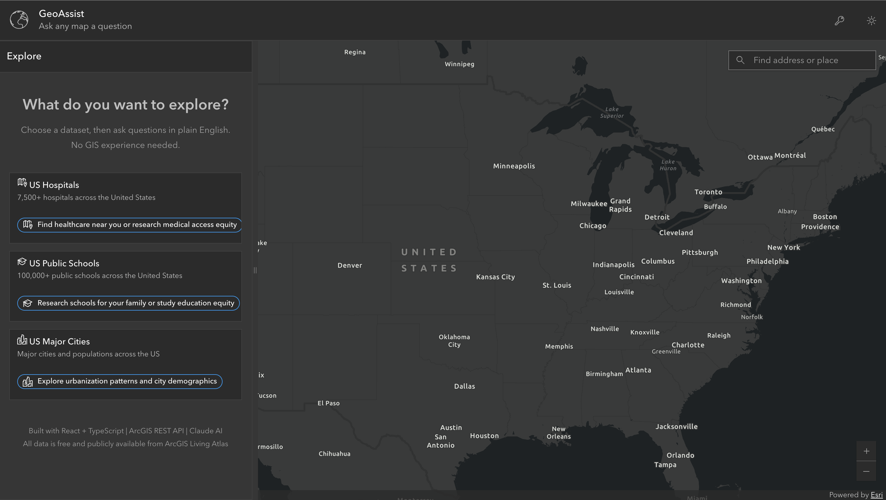

# GeoAssist

GeoAssist is a React + TypeScript web app that lets people ask plain-English questions against public ArcGIS Feature Services and instantly see results on an interactive map.

**[Try the live demo →](https://aashisho1o1.github.io/GeoAssist/)**

[](https://aashisho1o1.github.io/GeoAssist/)

No API key needed for the example questions: they run pre-translated queries against the live ArcGIS services. Add a Claude API key to ask your own questions.

## Why This Project

Public GIS datasets are powerful but hard to query without ArcGIS REST syntax. GeoAssist translates natural language into ArcGIS query parameters so non-GIS users can explore hospitals, schools, and cities with no query-language training.

## Core Features

- Natural language to ArcGIS REST query translation using Claude (structured JSON output)
- Generated SQL is checked against each dataset's real field names before it runs
- Interactive ArcGIS map with result graphics and popup details
- Dataset selector for US hospitals, public schools, and major cities
- Chat-style query history and AI summary responses
- Query inspector to show generated `where`, `outFields`, and `orderByFields`
- Result list with click-to-highlight behavior on map
- Calcite-based UI with dark mode and keyboard-accessible controls

## Architecture Flow

1. User selects a dataset and submits a question.
2. `lib/translate.ts` sends the question, field list, and value notes to Claude, which returns query params as schema-checked JSON. Example questions skip this step and use their pre-translated query.
3. `lib/validateQuery.ts` rejects unknown fields and unsafe SQL.
4. `lib/arcgis.ts` calls `{featureServiceUrl}/query`.
5. `MapPanel` + `lib/mapGraphics.ts` render results and handle highlighting.
6. Sidebar shows chat summary, query inspector, and result list.

## Tech Stack

- React 19 + TypeScript (strict mode)
- Vite
- `@arcgis/map-components`
- `@esri/calcite-components`
- ArcGIS public Feature Services (Living Atlas)
- Anthropic Messages API (frontend direct for demo)

## Local Development

### Prerequisites

- Node.js 20+
- npm
- Claude API key (optional; only needed for your own questions)

### Install

```bash
npm install
```

### Run

```bash
npm run dev
```

### Build

```bash
npm run build
```

### Lint

```bash
npm run lint
```

## API Key Setup

- Open the app and click the **API Key** action in the header.
- Paste your Claude key (`sk-ant-...`) and save.
- The key is stored in browser `localStorage` under `geoassist_api_key`.

## Deployment (GitHub Pages)

1. In the repository, open **Settings** → **Pages**.
2. Under **Build and deployment** → **Source**, select **GitHub Actions**.
3. Push to `main`. The `Deploy to GitHub Pages` workflow builds the app and publishes `dist/` to **`https://aashisho1o1.github.io/GeoAssist/`**.

Notes:

- `vite.config.ts` uses `base: "/GeoAssist/"` for GitHub Pages project-site deployment.
- Static assets for Calcite and ArcGIS are copied into `public/assets` by:
  - `npm run copy:calcite`
  - `npm run copy:arcgis`

## Security Note

This portfolio version calls Anthropic directly from the browser (`anthropic-dangerous-direct-browser-access: true`) for speed of iteration.

For production, move LLM calls behind a backend proxy (FastAPI/Express) so API keys are never exposed client-side.
