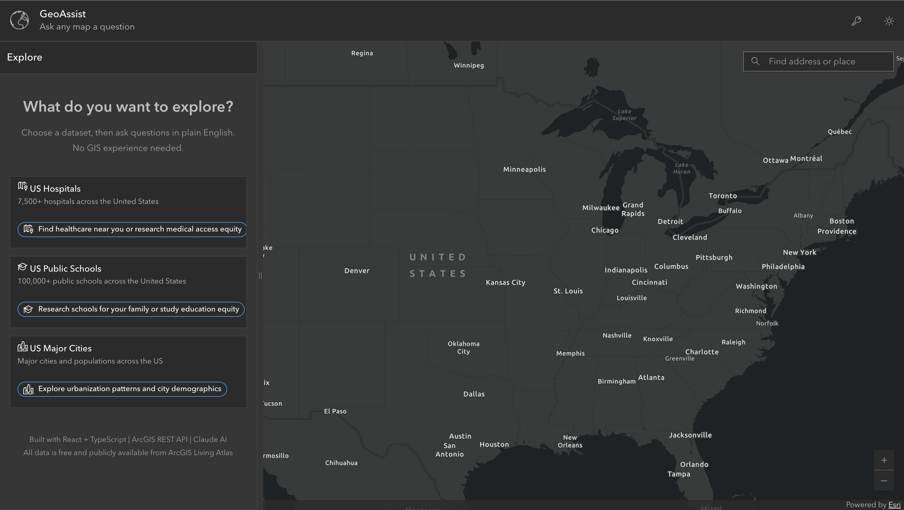

# GeoAssist

GeoAssist is a React + TypeScript web app that lets people ask plain-English questions against public ArcGIS Feature Services and instantly see results on an interactive map.

**[Try the live demo →](https://aashisho1o1.github.io/GeoAssist/)**

[](https://aashisho1o1.github.io/GeoAssist/)

No API key needed for the example questions: they run pre-translated queries against the live ArcGIS services. Add a Claude API key to ask your own questions.

## Why This Project

Public GIS datasets are powerful but hard to query without ArcGIS REST syntax. GeoAssist translates natural language into ArcGIS query parameters so non-GIS users can explore hospitals, schools, and cities with no query-language training.

## Core Features

- Natural language to ArcGIS REST query translation using Claude (structured JSON output)
- Generated SQL is checked against each dataset's field list before it runs
- Every answer says how many rows are shown and how many match in total ("Showing 50 of 798 matching results")
- The data source, the account that hosts it, and the layer's last-edit date are shown under the results
- Interactive ArcGIS map with result graphics and popup details
- Dataset selector for US hospitals, public schools, and major cities
- Chat-style query history and AI summary responses
- Query inspector to show generated `where`, `outFields`, and `orderByFields`
- Result list with click-to-highlight behavior on map
- Calcite-based UI with dark mode and keyboard-accessible controls

## Architecture Flow

1. User selects a dataset and submits a question.
2. `lib/translate.ts` sends the question, field list, and value notes to Claude, which returns query params as schema-checked JSON. Example questions skip this step and use their pre-translated query.
3. `lib/validateQuery.ts` rejects unknown fields and unsafe SQL.
4. `lib/arcgis.ts` calls `{featureServiceUrl}/query` twice in parallel: once for the rows to show, once with `returnCountOnly=true` for the total.
5. `MapPanel` + `lib/mapGraphics.ts` render results and handle highlighting.
6. Sidebar shows chat summary, query inspector, and result list.

## Tech Stack

- React 19 + TypeScript (strict mode)
- Vite
- `@arcgis/map-components`
- `@esri/calcite-components`
- Public ArcGIS Feature Services (see Data sources)
- Anthropic Messages API (frontend direct for demo)

## Local Development

### Prerequisites

- Node.js 20+
- npm
- Claude API key (optional; only needed for your own questions)

### Install

```bash
npm install
```

### Run

```bash
npm run dev
```

### Build

```bash
npm run build
```

### Lint

```bash
npm run lint
```

### Test

```bash
npm test
```

The tests cover the query validator, the row and count requests (with ArcGIS mocked, so they run offline), and the result summary. There are no UI tests yet.

## Data sources

| Dataset | Origin | Hosted on ArcGIS Online by | Layer last edited |
| --- | --- | --- | --- |
| Hospitals | HIFLD Hospitals | FEMA Region 6 GIS ([item](https://www.arcgis.com/home/item.html?id=38eebc0197034d59b331eaa7f753cdb0)) | August 2021. Newest source date inside the data: May 2018 |
| Public schools | HIFLD Public Schools, from NCES Common Core of Data | FEMA, account `FEMA_HQ_Preparedness_NIC` ([item](https://www.arcgis.com/home/item.html?id=963a2d204098495a8a80134ed9dc95ae)) | September 2025 |
| Major cities | Esri, US Census Bureau | Esri, ArcGIS Living Atlas ([item](https://www.arcgis.com/home/item.html?id=9df5e769bfe8412b8de36a2e618c7672)) | 2026 |

Dates are as checked on November 10, 2026. The app reads each layer's last-edit date from the service and shows it under the results. Only the cities layer is a Living Atlas item. The hospital and school layers are copies of HIFLD data that FEMA accounts host publicly. They are not marked authoritative on ArcGIS Online, and their owners can change or remove them. These are the same layers [geoassist-mcp](https://github.com/Aashisho1o1/geoassist-mcp) uses.

## How a generated query is checked

`lib/validateQuery.ts` runs before any request is sent:

- Quoted values are set aside first, so a hospital named "Select Specialty" is treated as a value and not as SQL.
- `;`, `--`, `/*` and the word `SELECT` are refused anywhere else in the WHERE clause.
- Every remaining word must be a field in the dataset or one of a short list of SQL words (`AND`, `OR`, `NOT`, `IN`, `LIKE`, `IS`, `NULL`, `BETWEEN`, `ESCAPE`, `UPPER`, `LOWER`, `TRIM`, `CHAR_LENGTH`).
- `outFields` and `orderByFields` may only name dataset fields, and ORDER BY may only add `ASC` or `DESC`.

## Limits

- Results are capped at 50 rows per question. The total shown comes from a separate count query. If that query fails, the app says the total is unknown.
- Counting questions ("how many hospitals are in Texas?") get a list plus the total, not a computed answer. Sums, averages, and group-by questions are not supported yet.
- The field lists and value hints in `data/datasets.ts` are written by hand, so they can drift from the live layers.
- The validator checks field names and SQL shape, not values. A filter with a real field and a value that isn't in the layer returns no results without an explanation.
- Closed hospitals are included unless the question excludes them.
- Each question is sent to Claude on its own. Follow-up questions that depend on the previous answer do not work.
- The hospital layer is an old snapshot. See Data sources.

## API Key Setup

- Open the app and click the **API Key** action in the header.
- Paste your Claude key (`sk-ant-...`) and save.
- The key is stored in browser `localStorage` under `geoassist_api_key`.

## Deployment (GitHub Pages)

1. In the repository, open **Settings** → **Pages**.
2. Under **Build and deployment** → **Source**, select **GitHub Actions**.
3. Push to `main`. The `Deploy to GitHub Pages` workflow builds the app and publishes `dist/` to **`https://aashisho1o1.github.io/GeoAssist/`**.

Notes:

- `vite.config.ts` uses `base: "/GeoAssist/"` for GitHub Pages project-site deployment.
- Static assets for Calcite and ArcGIS are copied into `public/assets` by:
  - `npm run copy:calcite`
  - `npm run copy:arcgis`

## Security Note

This portfolio version calls Anthropic directly from the browser (`anthropic-dangerous-direct-browser-access: true`) for speed of iteration.

For production, move LLM calls behind a backend proxy (FastAPI/Express) so API keys are never exposed client-side.
